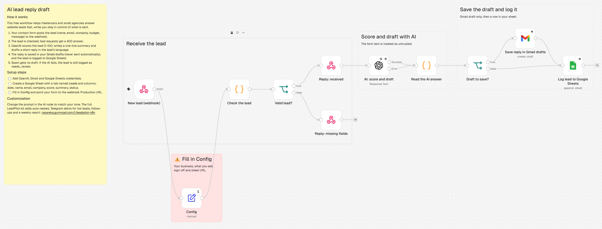
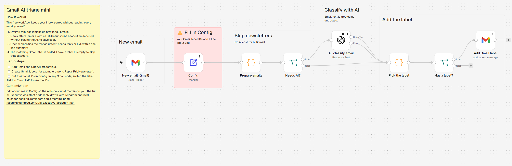

# Free n8n workflows by Rasa Reka

Two small, production-minded n8n workflows you can import in a minute. Both were tested on **n8n 2.47.7**: imported, then run end to end against mocked services (6 scenarios).

📬 **New free workflows by email:** [rasareka.com/n8n](https://rasareka.com/n8n/?ref=github). About one email every two weeks, unsubscribe any time.

| Workflow | What it does | You need |
|---|---|---|
| [01 · AI lead reply draft](workflows/01-ai-lead-reply-draft.json) | Scores a website form lead (0–100), writes a personal reply in the lead's language and **saves it to Gmail drafts** for you to send. It also logs every lead to Google Sheets. | OpenAI, Gmail, Google Sheets |
| [02 · Gmail AI triage mini](workflows/02-gmail-ai-triage-mini.json) | Labels every new email as Urgent, Needs reply or FYI with OpenAI. Newsletters are labelled **without** an AI call to save cost. | OpenAI, Gmail |

---

## 01 · AI lead reply draft



**How it works**
1. Your contact form POSTs `name`, `email`, `company`, `budget` and `message` to the webhook. Both JSON and form posts work.
2. Bad requests (no valid email or no message) get a `400` reply.
3. OpenAI scores the lead, writes a one-line summary and drafts a short reply. The form text is treated as untrusted input.
4. The reply goes to **Gmail drafts**, never sent automatically. The lead is appended to the `Leads` tab of your sheet.
5. Spam gets no draft. If the AI call fails, the lead is still logged as `needs_review`.

**Setup (about 5 minutes)**
1. Import the JSON: in n8n, open **⋯ → Import → From File**.
2. Add OpenAI, Gmail and Google Sheets credentials.
3. Create a Google Sheet with a tab named **Leads** and these columns: `date, name, email, company, score, summary, status`.
4. Fill in the **Config** node: business name, what you sell, sign-off and sheet URL.
5. Publish, then point your form to the webhook's **Production URL**.

Test it:
```bash
curl -X POST "https://YOUR-N8N/webhook/lead-reply-draft" -H "Content-Type: application/json" \
  -d '{"name":"Sam","email":"you@yourdomain.com","company":"Sam Bakery","message":"Need a website before December"}'
```

> **Want the full version?** [**LeadPilot**](https://rasareka.gumroad.com/l/leadpilot-n8n?ref=github) ($29) is 5 tested workflows:
> - instant replies with a safety net;
> - Telegram alerts for hot leads;
> - AI follow-ups that stop when the lead replies;
> - Google review requests;
> - a weekly pipeline report.

---

## 02 · Gmail AI triage mini



**How it works**
1. Every 5 minutes it picks up new inbox emails.
2. Emails with a `List-Unsubscribe` header are filed as newsletters without an AI call.
3. OpenAI classifies the rest as `urgent`, `needs_reply` or `fyi`.
4. The matching Gmail label is added. Leave a label ID empty to skip that category.

**Setup (about 5 minutes)**
1. Import the JSON and add Gmail and OpenAI credentials.
2. In Gmail, create labels, for example Urgent, Reply, FYI and Newsletter.
3. Put the label IDs in **Config**. To see the IDs, open any Gmail node and switch its label field to *From list*.
4. Edit `about_me` so the AI knows what matters to you, then publish.

> **Want the full version?** The [**AI Executive Assistant**](https://rasareka.gumroad.com/l/ai-executive-assistant-n8n?ref=github) ($49) works in Telegram:
> - triage plus reply drafts that are sent only after you tap Approve;
> - calendar booking with free-time search;
> - tasks, reminders and a morning brief;
> - voice notes.

---

## Notes
- **Data sent to OpenAI:**
  - workflow 01 sends the lead's form fields;
  - workflow 02 sends the sender, subject and the first 4,000 characters of each non-newsletter email.
- **Credentials** stay in your n8n instance. These files contain no keys.
- **Models:** both use `gpt-4.1-mini` by default. You can change the model in Config.

## License

MIT. Use, change and share these two workflows freely. See [LICENSE](LICENSE).

Made by **Rasa Reka**. Questions: hello@rasareka.com
